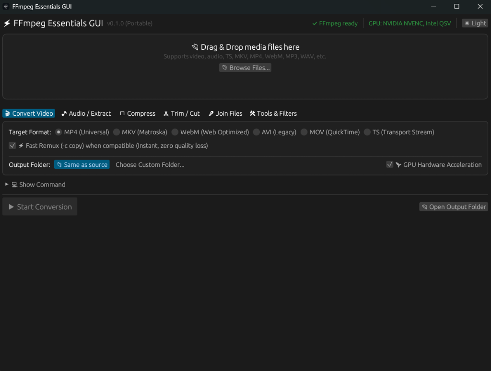

# 🎬 FFmpeg Portable GUI

[](https://github.com/Sazin31/ffmpeg-portable-gui/releases)
[](https://www.rust-lang.org)
[-0078D6?style=flat-square&logo=windows)](https://microsoft.com)
[](LICENSE)
[]()
[]()

A portable, ultra-lightweight Windows desktop GUI wrapper around **FFmpeg** (the essentials build). Designed for everyday video and audio conversions with **zero command-line knowledge required**.

---

## ✨ Features at a Glance

<div align="center">
  
</div>

- 🚀 **100% Portable**: No installer, no registry modifications, no administrator rights needed. Works directly from a USB stick.
- 🪶 **Tiny Executable**: The app binary is only **~3.3 MB** (built in Rust using `eframe`/`egui` with size optimization and static CRT).
- 🔒 **100% Offline & Private**: Zero telemetry, zero external network requests.
- ⚡ **Instant Fast Remux (`-c copy`)**: Automatically detects container/codec compatibility (e.g. TS to MP4, MKV to MP4) and skips re-encoding entirely for instant, zero-quality-loss conversion.
- 🛡️ **Zero Missing-Tool Hassle**: Does **NOT** require `ffprobe`. All media inspection (codecs, resolution, duration) is parsed cleanly from `ffmpeg -i` stderr.
- 🪟 **Clean Background Subprocesses**: Runs FFmpeg with the Windows `CREATE_NO_WINDOW` flag (`0x08000000`) so no command prompt windows ever flicker on screen.
- 💾 **Safe Renaming**: Never silently overwrites your files. Automatically increments output names (`video_1.mp4`, `video_2.mp4`).
- 🎮 **Hardware Acceleration**: Auto-detects **NVIDIA NVENC**, **Intel QSV**, and **AMD AMF** on your machine with seamless automatic fallback to software encoding if unsupported.

---

## 🛠️ Main Tools & Presets

| Category | Presets & Capabilities |
|---|---|
| **Video Conversion** | Convert between **MP4**, **MKV**, **WebM**, **AVI**, **MOV**, and **TS**. |
| **Audio Extraction & Conversion** | Extract or transcode to **MP3** (libmp3lame `-q:a 2`), **Opus** (libopus 32k/64k/96k/128k), **AAC**, **FLAC**, **WAV**, **OGG**. If source is already in target format, instant `-c:a copy` is used. |
| **Fast Remux** | Lossless container switching (`-c copy`) from TS/MKV to MP4 in seconds. |
| **Video Compression** | Presets for **Small** (CRF 28), **Balanced** (CRF 23), and **High Quality** (CRF 18) using **H.264** or **H.265 (HEVC)**. Optional max resolution caps (1080p, 720p, 480p). |
| **Trim & Cut** | Custom start/end timestamps with instant **Fast (copy)** or frame-accurate **Precise (re-encode)** modes. |
| **Join / Merge** | Concatenate multiple clips of the same format into one file via concat demuxer, with drag-and-drop reordering. |
| **Transform & Rotate** | Resize (50%, 720p, 1080p, 4K), rotate (90° CW, 180°, 270° CW), flip horizontally/vertically, and speed adjustments (0.5x to 2.0x). |
| **Audio Tools** | Mute/strip audio (`-an`), replace or add audio track, normalize volume (**EBU R128 loudnorm**), volume multiplier slider (10% - 300%), mono/stereo downmixing. |
| **GIF & Thumbnails** | Two-pass animated GIF generation using `palettegen` and `paletteuse` to eliminate color dithering artifacts. High-res still thumbnail capture at any timestamp. |
| **Subtitles** | Extract embedded subtitles to `.srt`, or burn in external `.srt`/`.ass`/`.vtt` subtitles directly into the video frames. |

---

## 📦 Download & Setup

### Option 1: Standalone Portable (Recommended)
1. Download the latest **`ffmpeg-portable-gui-windows-x64.zip`** from [Releases](../../releases).
2. Extract the folder anywhere (e.g. Desktop, Downloads, or a USB stick).
3. Place `ffmpeg.exe` (from [gyan.dev essentials build](https://www.gyan.dev/ffmpeg/builds/)) in the same folder or in a `bin/` subfolder.
4. Run `ffmpeg-portable-gui.exe`!

### Option 2: Use System FFmpeg (via `winget`)
If you prefer not keeping a copy of `ffmpeg.exe` in the folder, install FFmpeg once on Windows:
```powershell
winget install Gyan.FFmpeg
```
Then simply download and run `ffmpeg-portable-gui.exe` anywhere — it automatically discovers FFmpeg in your system `PATH`.

---

## 🏗️ Building from Source

### Prerequisites
- [Rust toolchain](https://www.rust-lang.org/tools/install) (1.80 or newer)
- Target: `x86_64-pc-windows-msvc` or `x86_64-pc-windows-gnullvm`

### Build Command
```powershell
# Clone the repository
git clone https://github.com/Sazin31/ffmpeg-portable-gui.git
cd ffmpeg-portable-gui

# Compile release build optimized for minimal executable size
cargo build --release
```

The optimized binary will be created at:
```
target/release/ffmpeg-portable-gui.exe
```

### Release Profile Configuration (`Cargo.toml`)
```toml
[profile.release]
opt-level = "z"     # Optimize strictly for size
lto = true          # Link Time Optimization across all dependencies
codegen-units = 1   # Maximum size reduction and dead-code stripping
panic = "abort"     # Strip unwind tables
strip = true        # Strip debug symbols and line tables
```

---

## 🧪 Automated Testing Checklist

The test suite covers full end-to-end FFmpeg execution:
```powershell
cargo test
```

- [x] **TS to MP4 (Fast Remux)**: Stream-copies MPEG-TS into MP4 in <0.05 seconds with zero transcoding.
- [x] **MP4 to MP3 Extraction**: High-fidelity VBR MP3 extraction (`libmp3lame -q:a 2`).
- [x] **MP4 to Opus**: High-efficiency Opus audio encoding (`libopus -b:a 128k`).
- [x] **Video Compression**: Transcodes video using CRF 28 and medium preset with audio copy.
- [x] **Trim / Cut**: Trims start and end timestamps.
- [x] **Join (Concat Demuxer)**: Merges multiple files with automatic list generator.
- [x] **Video to GIF**: Generates high-quality animated GIF using two-pass palette filters.

---

## 👤 Author

- **[Sazin Ahmed (@Sazin31)](https://github.com/Sazin31)** — Creator & Maintainer

---

## 📄 License

This project is licensed under the [MIT License](LICENSE).
FFmpeg is a trademark of Fabrice Bellard and is licensed under the LGPL/GPL.
